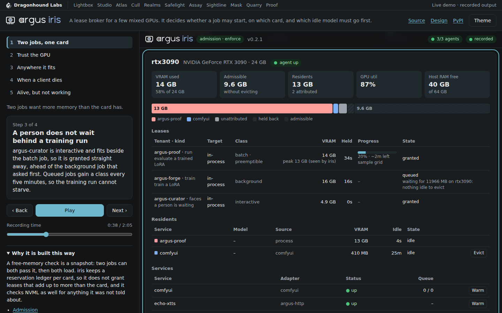

# argus-iris

[](https://github.com/smk762/argus-iris/actions/workflows/ci.yml)
[](https://pypi.org/project/argus-iris/)
[](https://github.com/smk762/argus-iris/blob/main/LICENSE)

**A GPU lease broker for a small fleet of mixed cards.** Image generation, LLMs, speech and training jobs share a few
GPUs, each assuming it owns the card, until one of them runs out of memory. iris decides whether a job may start now,
on which node, and which idle model must be unloaded first. It never runs the work.

**[Try the guided demo](https://iris.dragonhound.dev)**: the published broker and its real dashboard, replayed on simulated
cards ([how it was recorded](https://github.com/smk762/argus-iris-demo#how-it-was-recorded)).

[](https://iris.dragonhound.dev)

```
 callers (argus-cortex client)          dashboard          Prometheus
       │ leases, heartbeats                │ SSE               │
       ▼                                   ▼                   ▼
 ┌───────────────────────── broker (:8120) ─────────────────────────┐
 │  queue and admission · VRAM ledger · residency policy · registry │
 │  adapters: ComfyUI · Ollama · argus-http · external              │
 └────────┬──────────────────────┬──────────────────────┬───────────┘
   agent @ rtx3090        agent @ rtx4060        agent @ gtx1070
   NVML, cgroups, allow-listed container start/stop/restart
```

## What it does

- **Reserves VRAM.** With `admission: enforce`, a lease that does not fit is queued, sent to another node that has
  room, or given room by evicting the least recently used idle models. Priority classes age, so nothing starves.
- **Checks the GPU, not the service.** An eviction counts only when NVML shows the memory came back. What a service
  keeps anyway (a CUDA context, an allocator cache) is measured and reported.
- **Survives clients that don't clean up.** Leases expire without heartbeats. A job that heartbeats but does no GPU
  work is flagged as stalled and asked to yield.
- **Fails open.** If the broker is down, the client falls back to its local lease and work continues.
- **Is adopted gradually.** Admission starts in `observe`, and each residency rule only reports until it says
  `enforce: true`.
- **Finds services itself.** Services register with a URL and a token; the node agents' container inventory says where
  they run. A caller can never name a host for the broker to contact.

## Try it

You need Docker with the NVIDIA container runtime, and Compose.

```bash
git clone https://github.com/smk762/argus-iris && cd argus-iris
cp deploy/.env.example deploy/.env               # set IRIS_AGENT_NODE, IRIS_AGENT_TOKEN and HOST_IP (this host's LAN IP)
cp deploy/iris.example.yaml deploy/iris.yaml     # set your nodes and services
docker compose build && docker compose up -d     # broker and agent on this host
```

Open `http://<HOST_IP>:8120/ui/`. Ports bind to localhost unless `HOST_IP` is set. Read [SECURITY.md](https://github.com/smk762/argus-iris/blob/main/SECURITY.md) before exposing either port: the agent holds the
Docker socket.

Or from PyPI: `pip install 'argus-iris[server,cli]'` for the broker, `pip install 'argus-iris[agent,cli]'` for a node.

## Read more

- [DESIGN.md](https://github.com/smk762/argus-iris/blob/main/DESIGN.md): the problem, admission, scheduling and eviction, and what is built or still planned.
- [docs/operating.md](https://github.com/smk762/argus-iris/blob/main/docs/operating.md): deployment, adding services and GPU hosts, leases, the service directory.
- [.octopus/](https://github.com/smk762/argus-iris/blob/main/.octopus/README.md): deploying with Octopus Deploy, staging first, with runbooks. The write-up: [Moving a GPU broker from hand-run compose to Octopus Deploy](https://dragonhound.dev/updates/2026-11-28-iris-octopus-deploy/).
- [SECURITY.md](https://github.com/smk762/argus-iris/blob/main/SECURITY.md): what each port can do, and how it is guarded.

## Develop

```bash
make install   # venv + editable install with the "dev" extras
make test
make lint
```

The version comes from git tags (`hatch-vcs`). CI and release use the shared
[argus-ci](https://github.com/smk762/argus-ci) workflows; a `v*` tag publishes to PyPI and GHCR.

iris is part of the [Argus suite](https://github.com/smk762?tab=repositories&q=argus). The client and wire models live in
[argus-cortex](https://github.com/smk762/argus-cortex).
